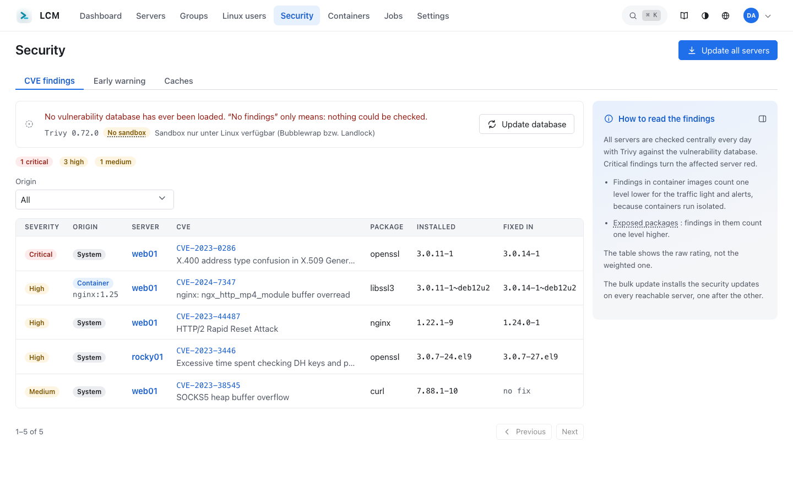

---
sidebar:
  order: 12
title: Security & CVE Scans
description: SSH hardening, firewall, 2FA, and the central Trivy CVE scan of the package inventory.
---

LCM bundles several security features - for the managed servers and for
the LCM instance itself. The deeper fundamentals (argon2id, sessions, RBAC,
encryption) are covered in the [Security Model](/en/reference/security-model/).

## CVE scan of the package inventory (Trivy)

The package inventory of **all** servers, centrally recorded in the database, is
regularly checked against the Trivy vulnerability database - **agentless**:
per server, a CycloneDX SBOM is generated from the package records and scanned
locally on the LCM host with `trivy sbom`. The managed servers are
**not** contacted again for this.

- **Schedule:** cron configurable (*Settings → Security*, card
  "CVE scan"), default daily 02:30.
- **After package updates:** whenever LCM updates packages (all/security/targeted
  updates, manually or via a rule), the package inventory is re-read and the
  server's CVE assessment is **re-run immediately and automatically** - so no
  stale security labels linger on packages that have already been fixed.
  (Only when the CVE scan is enabled and Trivy is available.)
- **Status effect:** critical CVE → status 🔴, high CVE → 🟡, each with
  an insight explanation. Badges sit right on the affected package row.
- **Views:** per server in the *Security* tab, globally on the *Security* page
  in the *CVE findings* tab (most critical first).
- **Graceful degrade:** if Trivy is missing on the LCM host, the feature
  disables itself cleanly (notice in the UI and job log). Trivy is in no
  standard package source of Debian/Ubuntu and is therefore set up separately
  - see [Installation](/en/getting-started/installation/).
- **Alerts:** the "Vulnerabilities (CVE)" alert rule notifies from a
  configurable minimum severity - see [Alerts](/en/guides/alerts/).

Docker images are scanned by the same procedure, see
[Docker Monitoring](/en/guides/docker/).

### The scanner runs sandboxed

Trivy is a child process of LCM and would therefore run with the same rights -
reaching `/var/lib/lcm`, where the database and the master key sit next to each
other. From those, the SSH keys and passwords of **all** managed servers could
be decrypted. This is not theory: in the Trivy supply chain compromise of March
2026, the injected binaries searched more than 50 paths for exactly this kind
of data.

LCM therefore starts the scanner in a sandbox. Of LCM's files, only what the
scan genuinely needs is visible:

| Visible to Trivy | Access |
| --- | --- |
| Trivy binary, system libraries, CA certificates | read |
| the generated SBOM (a single file) | read |
| the vulnerability database cache directory | read + write |
| its own, empty `/tmp` | read + write |

Everything else - `app.db`, `lcm.key`, `/etc/lcm`, the home directories - simply
**does not exist** for that process: a read attempt ends with "no such file",
not with "permission denied".

On top of that comes network separation: the **SBOM scan only evaluates the
local database and runs without any network at all**. Even a tampered scanner
would have no way out. Only the database download and the image scan get a
connection, because they cannot work without one.

This is implemented with **bubblewrap** (its own mount and network namespace,
installed together with Trivy). If it is missing, **Landlock** takes over,
provided the kernel has it enabled - careful: many kernels ship Landlock but do
not list it among the active LSMs (`/sys/kernel/security/lsm`); the Proxmox
kernel, for instance, does not without an `lsm=` boot parameter.

Both ways give the process its own minimal environment: `PATH`, an empty
`HOME` and, if set, proxy settings and custom certificates (`HTTPS_PROXY`,
`NO_PROXY`, `SSL_CERT_FILE` …). Everything else from LCM's environment stays
out, including an `LCM_ENCRYPTION_KEY` set there. Bubblewrap needs version 0.5
or newer for this; an older one falls back to Landlock.

If neither is available, the scan runs unsandboxed as before - but with a
**visible notice** on the scanner display. A silent fallback would be the worst
option: you would believe yourself protected without being so.

### Status weighting

For **status and alerts**, the raw Trivy severity is weighted by context (the
*Security* page still shows the **raw** rating):

- **Docker CVEs do not count by default** - container isolation limits the
  blast radius, and the image vendor is responsible for image contents. Only
  containers switched on in the *In the status* column of a server's
  *Containers* tab count, at full severity (see
  [Status calculation](/en/guides/status/)).
- **CVEs of exposed packages one level higher** - web servers, reverse proxies,
  mail/DNS/file servers, databases, etc. The list is maintained under *Settings →
  Security* (field *Higher weighted packages*); LCM additionally detects packages
  listening on externally reachable ports and weights them up automatically.

### Security page: bulk update & origin filter



The **Security** page (global CVE overview) offers two tools:

- **Update all servers** - applies security updates on all reachable servers, one
  after another. A dialog asks first (with the effects and a command
  preview). While running, the button is disabled and the progress ("x of N
  servers done") appears next to it; afterwards it reports how many were
  updated or failed. At most one bulk run happens at a time.
- **Origin** - a filter with *All*, *Operating system only* and *Container
  images only*. Each row's origin is marked with a **System** or **Container**
  badge.

### Operating system out of support (EOL)

If a server runs a distribution that is **no longer receiving security updates**
(end-of-life) **or reaches end of support in less than a month**, the server is
classified as **red/critical** - regardless of individual CVEs. Support
timelines (Ubuntu/Debian release cycles) are built into LCM; the server detail
shows a "supported until …" or "support ends soon" badge.

### Status tier "Excellent"

Above 🟢 OK there is the **"Excellent"** tier (rich green): spotless - **not a
single** known CVE, SSH hardened **and** firewall active (Proxmox brings its own
firewall and counts as covered).

### How current is the vulnerability database?

The vendor rebuilds the database every six hours. LCM checks every hour whether
there is a new version and fetches it itself. Scans do not download anything.

The download runs in the background in its own directory. Scans keep working with
the current database in the meantime. LCM only replaces it once the new one is
complete, and a running scan finishes on the old one. If the download fails, the
current database stays unchanged. For the swap the LCM host temporarily needs
about 2 GB of extra disk space.

A new database only changes the findings with the next CVE scan. That scan runs
on its schedule, the sync does not start one. You find the sync under
*Settings → Schedules* as *Sync CVE database*.

If the LCM host is isolated, sits behind a proxy or hits a rate limit, the old
database stays in place. Scans do not report that as an error but, if in doubt,
as "no vulnerabilities found".

That is the dangerous variant: a three-week-old database looks exactly like a
genuinely clean server. LCM therefore states the database state explicitly:

- The **Security** page shows above the findings list when the database is from
  - with a warning if it is outdated. How much the list below is worth depends
  on exactly that.
- The server detail of the **LCM host** shows Trivy version and database state
  right on the Trivy card.
- If the database is outdated, every server gets a **note** in its status
  popover. Deliberately only a note: the traffic light stays unchanged, because
  this is a problem of the LCM host - colouring all servers for it would report
  one single cause as many server problems.

What counts is **when the vendor built the database**, not when this host
fetched it: re-downloading the same old database daily still leaves you with old
data.

| Age | Tier | Effect |
|---|---|---|
| < 48 h | current | nothing shown |
| from 48 h | outdated | warning on the security page, note per server, alert |
| from 7 days | critical | as above, more prominently marked |

The 48 hours deliberately survive one failed nightly run without letting real
rot slip through.

**Updating the database**: the button on the security page checks right away
whether there is a new version and fetches it. It runs as a job - the log states
the version, or that there is no newer one. A failure lands in the log together
with Trivy's output, and that is exactly where the cause shows up (no network,
proxy, rate limit).

**Alert**: the rule *"CVE database outdated"* (Settings → Alerts) reports the
state actively. Without it the state would only surface if someone looked - for
a fault that looks like "no vulnerabilities" from the outside, that is the wrong
expectation. Only the LCM host is checked, since that is where the scanner is.

:::note[Outdated Trivy]
The **scanner version** needs no separate update check: LCM installs Trivy from
the Aqua APT repository, so it is a normal package of the LCM host and appears
in its update list like any other.
:::

### Which kernel is actually running?

The question sounds trivial and isn't: after a kernel update the new kernel is
**installed** but only runs after a reboot. The package list then claims
"everything up to date" while the machine keeps working with the old kernel -
including the holes the new one closes.

LCM separates the two cleanly:

- **Running kernel** - from `uname -r`. That is the only source that cannot
  lie: it reports the actually booted kernel, not what the package manager
  holds. Shown in the overview of the server detail page.
- **Installed kernels** - as a separate card, newest release first, each entry
  marked: *running*, *awaiting reboot* (newer than the running one) or
  *fallback* (older). The latter are what saves you when a new kernel does not
  boot - which is why they should be visible.

The list is collected per package manager with its own mechanism:

| System | Kernel packages |
|---|---|
| **Proxmox** (PVE/PBS/PMG) | `proxmox-kernel-*` and `pve-kernel-*` (older naming) |
| Debian / Ubuntu | `linux-image-*` |
| RHEL family (dnf/yum) | `kernel`, `kernel-core` |
| openSUSE / SLES | `kernel-default*` |
| Arch | `linux`, `linux-lts`, `linux-hardened`, `linux-zen` |
| Alpine | `linux-lts`, `linux-virt`, `linux-edge` |

Proxmox deliberately gets its own branch: there the kernels are **not**
provided by `linux-image` packages. A plain `linux-image` filter would simply
find nothing on a PVE host.

**Meta packages are skipped.** `linux-image-amd64` or `proxmox-kernel-6.8`
install no concrete kernel, they merely point at the newest one. Counting them
would distort the number of fallback kernels actually present.

:::note[In containers only the version counts]
In an **LXC container** (also Docker, OpenVZ, systemd-nspawn) the kernel of the
**host** is running. `uname -r` shows exactly that - installed kernel packages
would have no effect there. LCM therefore does not list them at all and shows
only the version with a corresponding note. There is no reboot finding either:
there is nothing you could restart from the inside.
:::

:::note[Keeping kernels]
Several kernels lying around is not an accident but a decision - and
`apt autoremove` undoes it. To keep the fallback, protect the kernel packages
with a [package pin](/en/guides/monitoring/#package-pins-what-the-cleanup-must-not-touch).
:::

## Early warning (OSV)

Next to the daily Trivy scan there is a **fast track**: early warning compares
the package inventory of all servers every 15 minutes with the online source
**OSV**. New advisories show up after minutes instead of with the next scan,
and it also knows advisories about **malicious packages** that the Trivy
database does not carry at all.

Early warning is off by default and is switched on under *Settings → Security*
(card "Early warning"):

- **Early warning** - switches on the regular query. For the online query the
  package inventory (names and versions, without server names) goes to the OSV
  service.
- **Local copy instead of online query** - LCM mirrors the OSV data (at night)
  and checks against the copy. The package inventory then stays in-house, but
  advisories arrive about a day later. *Update copy now* downloads the data
  again right away (a few megabytes, a few minutes).
- **Cache in minutes** - 0 turns it off, at most 30. While a result is valid,
  LCM does not ask again for that package.

Below that the card shows the state: off, online query or local copy, when it
was last checked and - with a local copy - the date of the copy and which
systems are mirrored.

The findings are on the *Security* page in the **Early warning** tab (severity,
known since, server, advisory, package, fixed in). Filters: *From severity* and
*Include resolved findings*. *Check now* asks the source for all servers right
away. Badges mark *Malicious package*, *Being exploited* and *no fix*. Clicking
a row opens the description with three actions:

- **Update package** - installs the fixed version.
- **Freeze version** - holds the package at the installed version as long as no
  fixed one exists, so that an update does not jump to an affected version.
- **Acknowledge** - the finding stays visible but no longer raises an alert.

Alerts for new findings come from the rule *"Early warning: new findings"*
(*Settings → Alerts*, see [Alerts](/en/guides/alerts/)); malicious packages
always fire.

### Caches

The **Caches** tab on the *Security* page shows how often a question was
already answered instead of causing work again. There are two caches that
measure different things:

- **Scan results (Trivy)** - same package inventory with the same database
  state means one Trivy run instead of many. The cache is bound to the state of
  the database.
- **Early warning queries (OSV)** - how many packages were answered from the
  cache instead of asking the online source. Without a configured validity the
  rate stays at zero; that is the setting, not a fault.

The count lives in memory and starts over with every restart of the service. A
low rate is not a flaw: with very different servers there is simply little to
repeat.

## SSH hardening

On the server detail page a server can be **hardened**: LCM writes an
`sshd_config` drop-in that restricts login to **certificates**
(password login off). The hardening can be reversed again via toggle. A
hardened server is reconnected via the system SSH key.

## Firewall (ufw)

Per server or as a group rule, **ufw** can be enabled and a list
of TCP ports to open can be set (SSH always stays open). As a **baseline rule**
the desired port configuration is checked on every connection and restored
on deviation.

## Two-factor authentication (2FA)

Any user can set up a TOTP method under *My account → Security*
(QR code for authenticator apps). Optionally, 2FA can be **enforced** for
certain roles (*Settings → Security*, card "Sign-in", field *Two-factor
required for*).

## Restricting network access to LCM (IP allowlist)

By default, any IP that can reach the LCM port may call the web UI and API
(access control then happens via login/RBAC). In addition, you can restrict
**network access** to specific client addresses - configured in `config.json`
(restart the service after changes). Clients that are not allowed receive a
**403** before login, logging or any controller runs.

```json
{
  "allowed_ips": ["private"],
  "trust_proxy_header": false,
  "trusted_proxies": []
}
```

Each entry in `allowed_ips` is either a **keyword** or an **IP/CIDR**:

| Entry | Effect |
|---|---|
| `[]` (default) | no restriction - any IP may connect |
| `["localhost"]` | only the local machine (`127.0.0.0/8`, `::1`) |
| `["private"]` | private networks (RFC1918, IPv6 ULA, link-local) + localhost |
| `["203.0.113.5", "10.0.0.0/8"]` | exactly these addresses/ranges |

Entries can be mixed, e.g. `["localhost", "192.168.10.0/24"]`.

:::caution[Behind a reverse proxy]
Filtering uses the **direct TCP connection** (spoof-proof). If LCM runs behind
a reverse proxy (e.g. for TLS), the direct peer is the proxy - in that case set
`"trust_proxy_header": true` so LCM takes the client IP from `X-Forwarded-For`,
**and** list the proxy address(es) in `trusted_proxies`. The header is believed
from those peers only; any other peer counts with its own address. Since 2.0,
without the list the header counts from no one, and the allowlist only sees the
proxy's address. Details and proxy examples:
[Reverse proxy & external hardening](/en/guides/reverse-proxy/).
:::

:::note[Docker healthcheck]
The Docker image checks health via `localhost`. With a restrictive allowlist
that omits `localhost`, the internal healthcheck fails - add `localhost` to the
list in that case.
:::

As an even stricter alternative, `"host": "127.0.0.1"` binds the service to the
loopback interface only (making it unreachable from outside entirely). The
allowlist is more flexible when selected remote addresses should be allowed.

## Access & roles

- **Admin** - full access.
- **Manager** - only assigned server groups (tenant separation at the
  query level).
- **Service accounts** - API keys with lifetime and scope (`read`/`readwrite`).

Details on permissions, tokens, and encryption:
[Security Model](/en/reference/security-model/).
